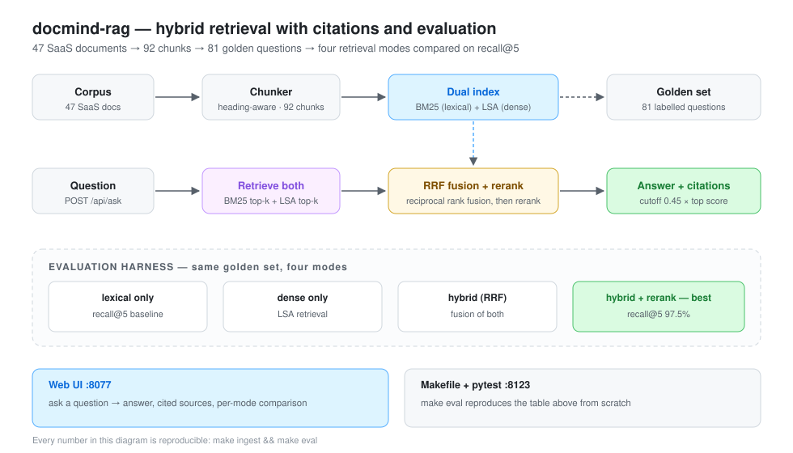
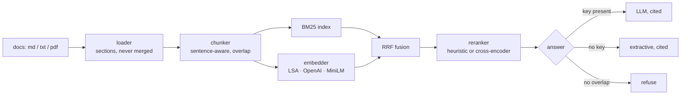

# DocMind



**A retrieval-augmented answering service that cites what it used and refuses when it has nothing.**

Built for the case most RAG demos skip: a support team with thousands of policy documents, where a confident wrong answer is worse than no answer.

```bash
make setup && make corpus && make ingest && make dev   # http://localhost:8000
```

No API key, no model download, no Docker. Clone it and it runs.

---

## What it does

Given a folder of documents (`.md`, `.txt`, `.pdf`), it:

1. **Chunks inside sections, never across them** — a chunk spanning two policy headings produces an answer that cites the right document and the wrong rule.
2. **Retrieves with two signals** — BM25 for exact terms and identifiers, dense vectors for wording variation, fused with Reciprocal Rank Fusion.
3. **Reranks the fused candidates** by scoring query and passage together rather than by rank consensus.
4. **Answers with citations**, or **refuses** when no passage overlaps the question.
5. **Measures itself** — a 81-question golden set and a four-configuration comparison you can re-run in one command.

---

## Results

Measured on the bundled corpus (47 documents → 92 chunks, 81 questions), single run, on a laptop CPU:

| mode | recall@1 | recall@3 | recall@5 | MRR@10 | p50 | p95 |
|---|---|---|---|---|---|---|
| `bm25` | 81.5% | 95.1% | 96.3% | 0.879 | 0.1 ms | 0.2 ms |
| `dense` | 80.2% | 91.4% | 96.3% | 0.870 | 0.1 ms | 0.1 ms |
| `hybrid` (RRF) | 81.5% | 95.1% | 96.3% | 0.879 | 0.4 ms | 0.6 ms |
| `hybrid + rerank` | 81.5% | **96.3%** | **97.5%** | **0.888** | 3.2 ms | 3.8 ms |

Recall@1 by question type — the part that actually tells you where the pipeline fails:

| question type | n | bm25 | dense | hybrid | hybrid + rerank |
|---|---|---|---|---|---|
| number | 26 | 88% | 85% | 88% | 85% |
| paraphrase | 22 | 77% | 77% | 77% | 77% |
| detail | 17 | 76% | 76% | 76% | **82%** |
| identifier | 7 | 71% | 71% | 71% | 71% |
| list | 5 | 80% | 80% | 80% | 80% |
| cross-doc | 2 | 100% | 100% | 100% | 100% |

### What these numbers actually say

Three findings, including the one that is not flattering:

1. **Reranking is the only stage that clearly earns its keep.** +1.2 pp recall@5, +2.5 pp MRR, and the largest single gain anywhere in the table: `detail` questions go from 76% to 82%. Reranking costs ~3 ms; that is a good trade.
2. **With the bundled offline embedder, the dense half adds nothing.** LSA is built from the same tokens BM25 indexes, so the two signals are correlated and RRF has nothing independent to fuse. The honest fix is a real encoder, not a more elaborate fusion formula — `DOCMIND_EMBEDDER=openai` swaps it in without touching retrieval code, and `make eval` re-measures in one command. **This is the reason the harness exists: it caught a layer that was not paying for itself.**
3. **The two permanent misses are both zero-lexical-overlap paraphrases** — "Which companies process my data on your behalf?" against a document that only ever says "Amazon Web Services… Cloudflare… Stripe". Nothing lexical can bridge that; it is the exact case a trained encoder is for. I left them in the golden set rather than deleting the evidence.

A 47-document corpus is also a small corpus. Recall@5 above 96% is less impressive than it looks, and the README says so on purpose.

---

## Architecture



| layer | file | note |
|---|---|---|
| loading | `src/docmind/ingest/loader.py` | markdown headings become citation anchors; PDFs fall back to pages |
| chunking | `src/docmind/ingest/chunker.py` | 900 chars, 180 overlap, sentence boundaries |
| lexical | `src/docmind/index/bm25.py` | 60 lines of Okapi, no dependency |
| dense | `src/docmind/index/embedder.py` | three backends behind one interface |
| fusion | `src/docmind/retrieve/hybrid.py` | RRF, k=60 |
| rerank | `src/docmind/retrieve/rerank.py` | idf coverage + bigrams + proximity + heading |
| answer | `src/docmind/generate/answer.py` | grounding gate before generation |
| evaluation | `src/docmind/eval/run_eval.py` | recall@k, MRR, latency, per-type breakdown |

---

## Design decisions worth arguing about

**Chunk inside a section.** Most implementations split on a fixed window and let chunks straddle headings. On policy documents that is how you get "refunds are available within 7 days" cited from the section about data retention.

**Fuse ranks, not scores.** BM25 scores are unbounded, cosine similarity is bounded. Normalising them into a shared space requires assumptions that break when the corpus changes. RRF only needs the ordering.

**Refuse before generating.** If no retrieved chunk shares a term with the question, the API returns "No passage covers this question" with zero citations and never calls the model. A test enforces this (`test_answer_without_match_says_so`) — it failed when first written, which is why the gate exists.

**Extractive fallback is a feature, not a stub.** Without an API key the service still answers, using the highest-overlap sentences verbatim, clearly labelled `extractive`. For a compliance-adjacent corpus, verbatim quotes are often more defensible than fluent paraphrase.

**Only passages near the top score may be cited.** Without this cutoff, a chunk sharing one word ("webhook") gets cited next to the real answer and citations stop meaning anything.

---

## Use your own documents

```bash
mkdir mydocs && cp /path/to/*.pdf mydocs/
python3 -m docmind.ingest.build --path ./mydocs
make dev
```

Then point `data/golden.jsonl` at your own questions — `{"question": ..., "gold": ["doc-id"]}` — and `make eval` gives you a baseline before you change anything. **Write the golden set before tuning.** Tuning without one is guessing with extra steps.

To use a real encoder:

```bash
export OPENAI_API_KEY=...
export DOCMIND_EMBEDDER=openai
make ingest && make eval
```

---

## Stack

Python 3.9+ · FastAPI · SQLite (chunks + float32 vectors) · numpy · vanilla JS UI (no build step) · optional: OpenAI, sentence-transformers

Why SQLite and not pgvector: the target here is "clone and it runs". The vector column is a float32 blob, and `src/docmind/index/store.py` is ~100 lines — swapping in pgvector touches nothing else.

---

## Limitations

- **Corpus scale.** 47 documents. Cosine scan in numpy is fine to ~100k chunks; beyond that, an ANN index (HNSW/IVF) is required.
- **No hybrid weighting learned from data.** Fusion is uniform RRF; a learned sparse-dense weight would help on heterogeneous corpora.
- **Answer quality without a key is extractive, not generative.** Good for auditability, poor for synthesis across three documents.
- **No incremental ingestion.** `make ingest` rebuilds; a production version would upsert changed documents by hash.
- **English-tuned.** The tokenizer and the bundled embedding have no multilingual handling.

## Tests

```bash
make test        # 8 tests: chunk boundaries, citation integrity, fusion order, refusal
```

MIT licensed.
