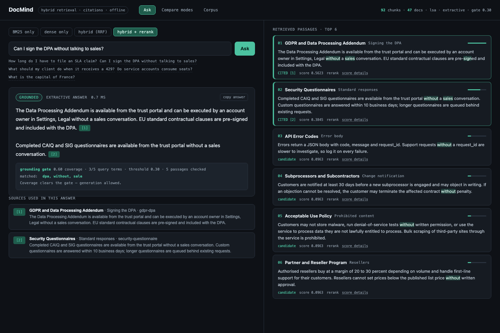
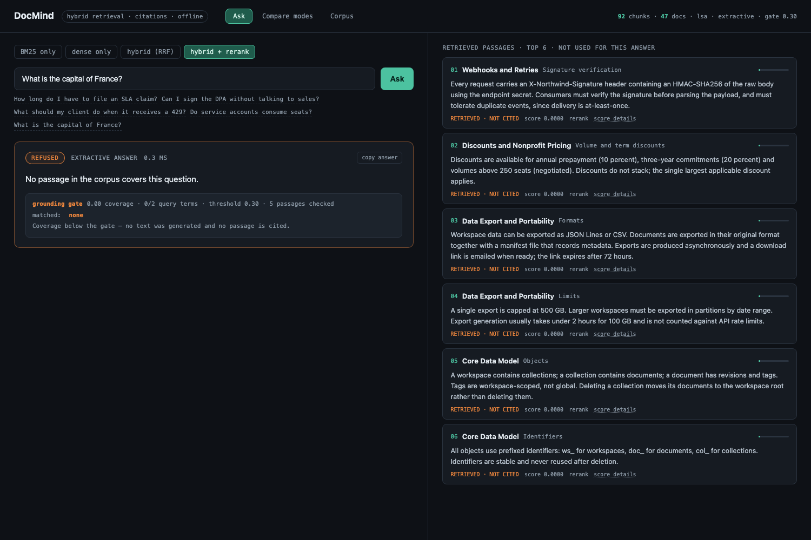
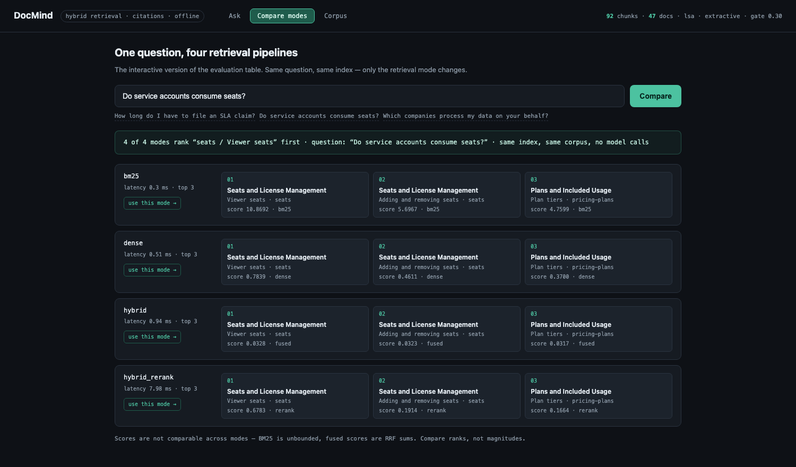
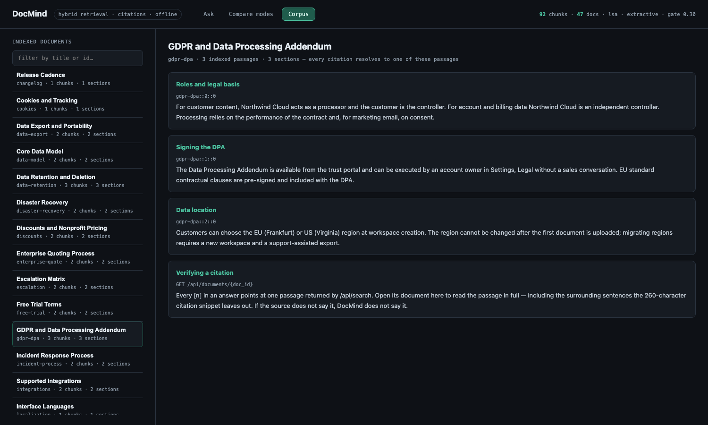
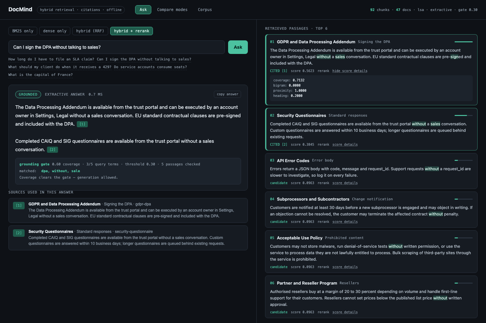
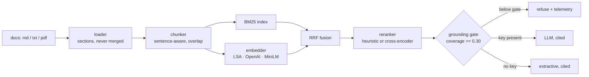

# DocMind




**A retrieval-augmented answering service that cites what it used, shows why it trusted it, and refuses when it has nothing.**

Built for the case most RAG demos skip: a support team with thousands of policy documents, where a confident wrong answer is worse than no answer.

```bash
make setup && make corpus && make ingest && make dev   # http://localhost:8000
```

No API key, no model download, no Docker. Clone it and it runs.

---

## What it does

Given a folder of documents (`.md`, `.txt`, `.pdf`), it:

1. **Chunks inside sections, never across them** — a chunk spanning two policy headings produces an answer that cites the right document and the wrong rule.
2. **Retrieves with two signals** — BM25 for exact terms and identifiers, dense vectors for wording variation, fused with Reciprocal Rank Fusion.
3. **Reranks the fused candidates** by scoring query and passage together rather than by rank consensus.
4. **Gates before generating** — measures how much of the question the top passages actually cover, and refuses with the numbers attached when coverage is below `0.30`.
5. **Answers with citations** that are ranks in the retrieved list, so `[2]` always resolves to passage 02; weak passages never earn a citation just for ranking second.
6. **Shows its work** — clickable citations, per-passage rerank scores, a four-mode comparison view, and a source browser for checking any quote against the original text.
7. **Measures itself** — an 81-question golden set, a four-configuration evaluation, and CI that fails if retrieval regresses.

---

## Results

Measured on the bundled corpus (47 documents → 92 chunks, 81 questions), single run, on a laptop CPU:

| mode | recall@1 | recall@3 | recall@5 | MRR@10 | p50 | p95 |
|---|---|---|---|---|---|---|
| `bm25` | 81.5% | 95.1% | 96.3% | 0.879 | 0.1 ms | 0.2 ms |
| `dense` | 80.2% | 91.4% | 96.3% | 0.870 | 0.1 ms | 0.1 ms |
| `hybrid` (RRF) | 81.5% | 95.1% | 96.3% | 0.879 | 0.4 ms | 0.6 ms |
| `hybrid + rerank` | 81.5% | **96.3%** | **97.5%** | **0.888** | 3.2 ms | 3.8 ms |

Recall@1 by question type — the part that actually tells you where the pipeline fails:

| question type | n | bm25 | dense | hybrid | hybrid + rerank |
|---|---|---|---|---|---|
| number | 26 | 88% | 85% | 88% | 85% |
| paraphrase | 22 | 77% | 77% | 77% | 77% |
| detail | 17 | 76% | 76% | 76% | **82%** |
| identifier | 7 | 71% | 71% | 71% | 71% |
| list | 5 | 80% | 80% | 80% | 80% |
| cross-doc | 2 | 100% | 100% | 100% | 100% |

### What these numbers actually say

Three findings, including the one that is not flattering:

1. **Reranking is the only stage that clearly earns its keep.** +1.2 pp recall@5, +0.009 MRR, and the largest single gain anywhere in the table: `detail` questions go from 76% to 82%. Reranking costs ~3 ms; that is a good trade.
2. **With the bundled offline embedder, the dense half adds nothing.** LSA is built from the same tokens BM25 indexes, so the two signals are correlated and RRF has nothing independent to fuse. The honest fix is a real encoder, not a more elaborate fusion formula — `DOCMIND_EMBEDDER=openai` swaps it in without touching retrieval code, and `make eval` re-measures in one command. **This is the reason the harness exists: it caught a layer that was not paying for itself.**
3. **The two permanent misses are both zero-lexical-overlap paraphrases** — "Which companies process my data on your behalf?" against a document that only ever says "Amazon Web Services… Cloudflare… Stripe". Nothing lexical can bridge that; it is the exact case a trained encoder is for. I left them in the golden set rather than deleting the evidence.

A 47-document corpus is also a small corpus. Recall@5 above 96% is less impressive than it looks, and the README says so on purpose.

---

## Screenshots

Every image below was captured from the running local app against the bundled corpus — no API key, no mocks, no retouching. The screenshot at the top shows a grounded answer; these show the other four views.

### Refusal, with the reason attached



`0.00 coverage · 0/2 query terms · threshold 0.30`. The passages a dense retriever pulled up are still displayed, but each is labelled **retrieved · not cited**, so nobody mistakes a nearest-neighbour hit for evidence. Zero citations are returned.

### One question, four retrieval pipelines



`POST /api/compare` runs all four modes against the same index and reports how many agree on the top document. Scores are not comparable across modes — BM25 is unbounded, fused scores are RRF sums — so compare ranks, not magnitudes.

### Verify a citation against the source text



The corpus browser reads `GET /api/documents/{doc_id}` and shows every indexed passage in full. If a quoted snippet looks suspicious, you can read the surrounding sentences it was cut from.

<details>
<summary>Rerank score breakdown (click to expand)</summary>



Each passage exposes the four heuristic signals — idf-weighted term coverage, bigram agreement, term proximity and heading agreement — so a ranking is debuggable instead of opaque.

</details>

The original first-pass UI is kept at [docs/ui-demo.png](docs/ui-demo.png) for comparison.

---

## Architecture



| layer | file | note |
|---|---|---|
| loading | `src/docmind/ingest/loader.py` | markdown headings become citation anchors; PDFs fall back to pages |
| chunking | `src/docmind/ingest/chunker.py` | 900 chars, 180 overlap, sentence boundaries |
| lexical | `src/docmind/index/bm25.py` | 60 lines of Okapi, no dependency |
| dense | `src/docmind/index/embedder.py` | three backends behind one interface |
| fusion | `src/docmind/retrieve/hybrid.py` | RRF, k=60 |
| rerank | `src/docmind/retrieve/rerank.py` | idf coverage + bigrams + proximity + heading |
| grounding | `src/docmind/retrieve/grounding.py` | question coverage over the union of top passages |
| answer | `src/docmind/generate/answer.py` | refuses before generation, then cites ranked passages |
| API + UI | `src/docmind/api/main.py` · `web/index.html` | JSON endpoints plus a dependency-free single-page UI |
| evaluation | `src/docmind/eval/run_eval.py` | recall@k, MRR, latency, per-type breakdown |

---

## API

The same `DocMind` service backs the CLI, the evaluation harness and the HTTP API, so all three measure exactly the same pipeline.

| method | path | returns |
|---|---|---|
| GET | `/api/health` | chunk / document counts, embedder, answer mode, gate threshold |
| GET | `/api/documents` | every indexed document with chunk and section counts |
| GET | `/api/documents/{doc_id}` | full source text grouped by section, for citation verification |
| POST | `/api/search` | ranked passages with scores and rerank components |
| POST | `/api/ask` | answer, `grounded`, `grounding` telemetry, citations |
| POST | `/api/compare` | all four retrieval modes on one question, with latencies |

```bash
curl -s localhost:8000/api/ask -H 'Content-Type: application/json' \
  -d '{"question":"Can I sign the DPA without talking to sales?","mode":"hybrid_rerank","top_k":6}'
```

`top_k` on `/api/ask` matters: citation numbers are positions in the returned passage list, and the UI asks both endpoints for the same depth so `[n]` always lands on passage `n`.

---

## Design decisions worth arguing about

**Chunk inside a section.** Most implementations split on a fixed window and let chunks straddle headings. On policy documents that is how you get "refunds are available within 7 days" cited from the section about data retention.

**Fuse ranks, not scores.** BM25 scores are unbounded, cosine similarity is bounded. Normalising them into a shared space requires assumptions that break when the corpus changes. RRF only needs the ordering.

**Gate on coverage, not on a shared word.** "Does any passage contain any query term?" is far too permissive: on this corpus, *"explain the mating habits of emperor penguins"* matches the single word `explain` and a fluent model will happily build a policy answer out of it. The gate instead measures what fraction of the question's content terms appear in the **union** of the top five passages. On the 81 golden questions the lowest legitimate score is `0.33`; unrelated questions peak at `0.25`. `0.30` separates them, is configurable via `DOCMIND_MIN_COVERAGE`, and is returned with every answer as `grounding` telemetry so a refusal is explainable rather than mysterious. Union rather than one passage matters — an answer is often spread across two chunks of the same document.

**Citation numbers are ranks, not a counter.** An earlier version numbered sources by "the nth passage we happened to quote", so skipping an unusable first passage silently shifted `[2]` onto passage 01. The UI numbers retrieved passages the same way the answer does; `test_citation_number_is_the_retrieved_rank` locks this down.

**A weak passage does not earn a citation by ranking second.** Only the top-scoring passage may be cited on a single shared query term; every other passage must match at least two, or it is dropped. This is what stops "how long does a refund take to arrive?" from citing the discounts document. `test_weak_second_passage_is_not_cited` covers it.

**Extractive fallback is a feature, not a stub.** Without an API key the service still answers, using the highest-overlap sentences verbatim, clearly labelled `extractive`. For a compliance-adjacent corpus, verbatim quotes are often more defensible than fluent paraphrase.

**Only passages near the top score may be cited.** A `0.45 × top score` cutoff keeps low-ranked chunks out; the term-support rule above handles the harder case — chunks that are close in score but unrelated in content.

---

## Use your own documents

```bash
mkdir mydocs && cp /path/to/*.pdf mydocs/
python3 -m docmind.ingest.build --path ./mydocs
make dev
```

Then point `data/golden.jsonl` at your own questions — `{"question": ..., "gold": ["doc-id"]}` — and `make eval` gives you a baseline before you change anything. **Write the golden set before tuning.** Tuning without one is guessing with extra steps. Also re-check `DOCMIND_MIN_COVERAGE`: a different vocabulary shifts the coverage distribution, and `/api/ask` returns the measured coverage with every answer so you can calibrate from real questions instead of guessing.

To use a real encoder:

```bash
export OPENAI_API_KEY=...
export DOCMIND_EMBEDDER=openai
make ingest && make eval
```

---

## Stack

Python 3.9+ · FastAPI · SQLite (chunks + float32 vectors) · numpy · vanilla JS UI (no build step) · GitHub Actions CI (3.9 + 3.11) · optional: OpenAI, sentence-transformers

Why SQLite and not pgvector: the target here is "clone and it runs". The vector column is a float32 blob, and `src/docmind/index/store.py` is ~100 lines — swapping in pgvector touches nothing else.

---

## Limitations

- **Corpus scale.** 47 documents. Cosine scan in numpy is fine to ~100k chunks; beyond that, an ANN index (HNSW/IVF) is required.
- **No hybrid weighting learned from data.** Fusion is uniform RRF; a learned sparse-dense weight would help on heterogeneous corpora.
- **Answer quality without a key is extractive, not generative.** Good for auditability, poor for synthesis across three documents.
- **No incremental ingestion.** `make ingest` rebuilds; a production version would upsert changed documents by hash.
- **The grounding threshold is calibrated on this corpus.** `0.30` was derived from the bundled golden set and a handful of unrelated probes. Point the service at your own documents and you should re-measure it; the harness and the telemetry make that a five-minute job, but it is not a universal constant.
- **English-tuned.** The tokenizer and the bundled embedding have no multilingual handling.

## Tests

```bash
make test        # 17 tests: chunk boundaries, BM25, fusion, grounding gate,
                 # citation-rank integrity, weak-passage rejection, document
                 # lookup, mode comparison, and the HTTP API via TestClient
```

CI (`.github/workflows/ci.yml`) runs the suite on Python 3.9 and 3.11, rebuilds the index offline, asserts `recall@5 >= 0.95` on the golden set, and checks that an unrelated question is refused. No secrets and no network calls are needed for any of it.

MIT licensed.
